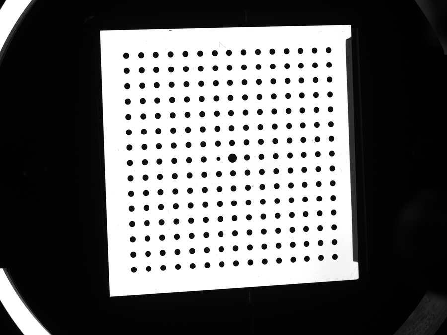
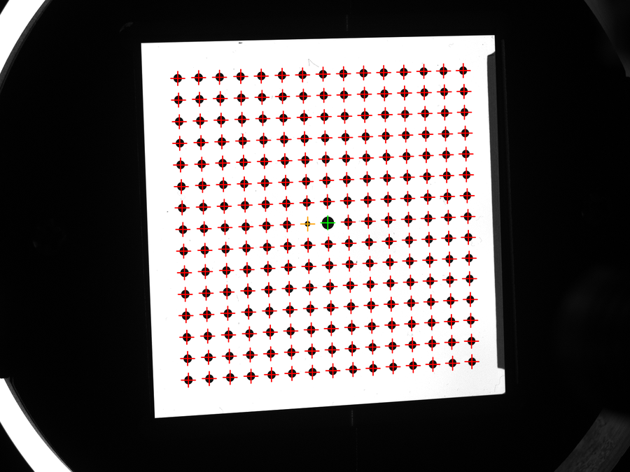
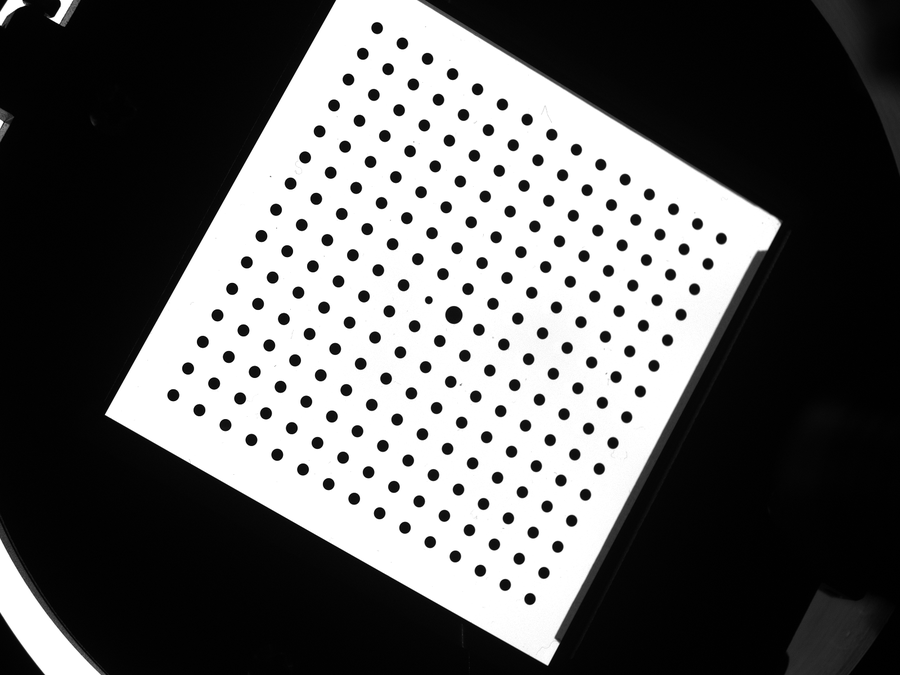
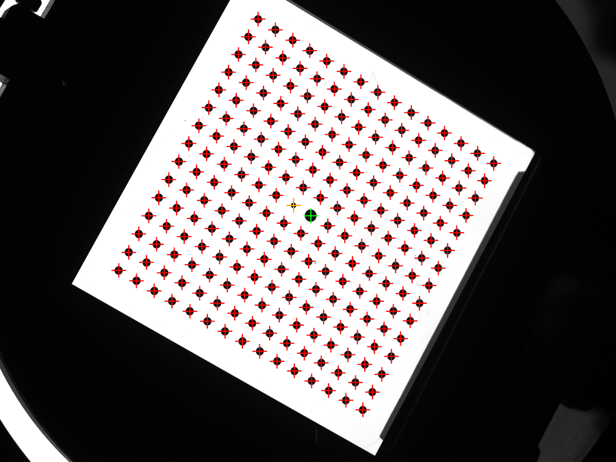
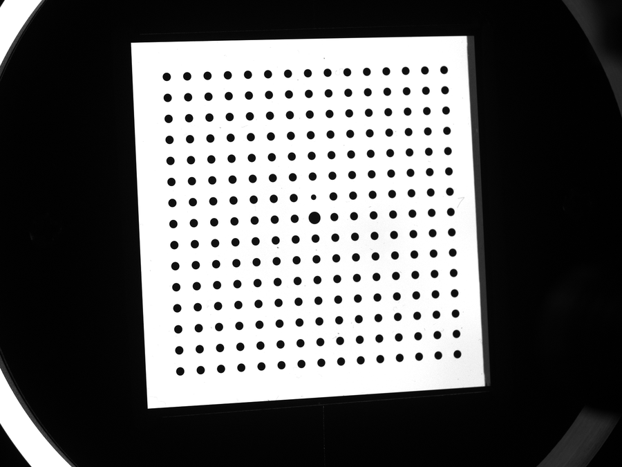
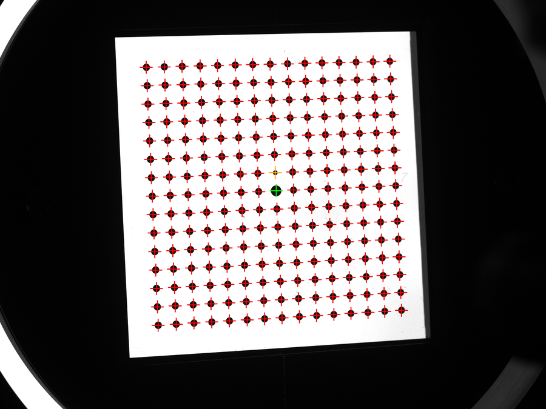

# 工业摄影测量作业 2：圆形标记点识别与中心提取

从二维圆点靶标图像中识别大、中、小圆形标记点，计算中心像素坐标（必做），并按行列编号（选做）。

## 效果展示

| 原图 | 识别效果（中心 + 拟合椭圆 + 分类） |
|---|---|
|  |  |
|  |  |
|  |  |

> 展示图为便于预览的缩略图；原始 BMP 位于 `images/`，完整结果（标注图、坐标 CSV）由程序输出到 `result/`。

## 1. 任务

| 类型 | 任务 | 交付 |
|---|---|---|
| 必做 | 识别大、中、小圆形标记点 | 类别 + 标注图 |
| 必做 | 计算中心坐标 | 像素中心 `(u, v)` + 坐标表 |
| 选做 | 按行列编号 | 行列号、编号、编号图 |

只依赖原始图像，不需要世界坐标和实际点间距。

## 2. 坐标与精度说明

- 图像坐标系：左上角为 `(0, 0)`，`u` 向右、`v` 向下，单位像素。
- 输出使用原始图像坐标；若检测时缩放或裁剪，需转换回原图。

需区分两种中心：

- **椭圆中心**：原图边缘拟合得到，实现简单，作为基础结果。
- **真实圆心的投影**：透视下与椭圆中心存在偏差，需借助板面几何修正。

本方案以椭圆拟合中心作为中心估计，报告需说明透视偏差未校正。

## 3. 必做流程

```text
读取原图
  ↓
空域去噪、阈值分割 → 干净二值图
  ↓
BFS／连通域标记
  ↓
按面积、长宽比、填充率筛出圆点
  ↓
fitEllipse 拟合，取椭圆中心 (u, v)
  ↓
按面积区分大、中、小圆
  ↓
输出标注图 + 坐标表
```

### 3.1 预处理与二值化

灰度化后进行空域去噪，用反向阈值使黑色圆点成为前景：

```text
I_binary = 1，若 I_gray < T
```

优先用 Otsu 自动阈值；光照不均时用自适应阈值或先做背景估计。

### 3.2 连通域标记

对二值图做 BFS 或 `connectedComponentsWithStats`，得到每个连通域的：

- 面积 `area`；
- 外接矩形宽高 `w, h`；
- 质心 `(cx, cy)`。

### 3.3 筛选圆点

按以下特征排除背景、板框和噪声：

- 面积范围：下限要保留小圆，上限排除大块背景；
- 长宽比 `w/h`：斜拍呈椭圆，阈值不能过严；
- 填充率 `area/(w*h)`：实心圆约为 `π/4 ≈ 0.785`；
- 是否接触图像或裁剪边界；
- 边缘是否过于曲折。

### 3.4 提取中心

连通域质心是像素面积重心，斜拍时受透视影响，**不直接作为高精度圆心**。对筛选后的轮廓做椭圆拟合：

```python
(cx, cy), (MA, ma), angle = cv2.fitEllipse(cnt)
```

- 至少需要 5 个轮廓点；
- 返回的是轴的完整长度，取半轴需除以 2；
- 以 `(cx, cy)` 作为中心估计。

需要更高精度时，可在拟合位置附近用灰度重心或亚像素边缘。

### 3.5 大、中、小圆分类

按面积或等效半径分类：

```text
r_eq = sqrt(area / π)
```

普通中圆数量最多时，用其中位面积作参考；透视明显时与附近普通圆比较。不要在所有图像上使用同一固定像素阈值。

## 4. 必做输出

每幅图像导出一个 CSV：

```csv
detection_id,type,u,v,area,semi_major,semi_minor
1,medium,442.10,195.40,310.00,10.20,9.80
2,large,816.20,555.10,700.00,15.20,14.80
3,small,765.40,557.80,140.00,6.90,6.50
```

| 字段 | 含义 |
|---|---|
| `detection_id` | 当前图像内部检测序号，非跨图像物理编号 |
| `type` | `large` / `medium` / `small` |
| `u, v` | 原图中心估计（像素） |
| `area` | 轮廓面积 |
| `semi_major, semi_minor` | 椭圆长、短半轴 |

同时输出标注图：绘制中心、拟合椭圆和序号，用颜色区分类别，并给出图例和各类数量。

检查：漏检、误检、重复检测、分类是否正确、坐标与图是否逐点对应。

## 5. 选做：行列编号

倾斜图像不能直接按 `u`、`v` 排序：同一行的点 `v` 可能不同，透视会使行列向消失点汇聚。可通过网格结构直接编号，或用单应矩阵辅助。

### 5.1 单应矩阵辅助编号

网格平面坐标到图像坐标满足：

```text
s · [u, v, 1]ᵀ = H · [X, Y, 1]ᵀ
```

`H` 有 8 个自由度。对已确认的等间距正方形网格，可定义 `(X, Y) = (col, row)`，无需真实间距。

**关键：求 `H` 需要两组一一对应的坐标，不能从无序中心直接求解。**步骤：

1. 先确定部分点（如四角）的行列，建立至少 4 对非退化对应点；
2. 用归一化 DLT 求初值，可用 `findHomography(..., cv2.RANSAC)` 剔除错误匹配；
3. 用 `H⁻¹` 映射其余中心，齐次归一化：

```text
q = H⁻¹ · [u, v, 1]ᵀ
X_est = q[0] / q[2]
Y_est = q[1] / q[2]
```

4. 按距离容差匹配整数网格位置，检查是否有重复占位或缺失；
5. 用更多可靠对应点重新估计 `H` 并检查残差。

### 5.2 显示编号

编号后**在原图检测中心旁标注，不改变显示位置**：

```python
cv2.putText(img, str(grid_id), (u + 6, v - 6),
            cv2.FONT_HERSHEY_SIMPLEX, 0.4, (0, 0, 255), 1, cv2.LINE_AA)
```

只需坐标逆映射即可判断行列，不必对整张图做逆变换；若确实要输出校正图像再用 `warpPerspective`。

逐行编号：

```text
grid_id = row × column_count + col + 1
```

漏点保留缺失网格位置，不压缩编号。检查行列方向、重复占位和跨图像一致性。

## 6. 与相机标定的关系（扩展）

后续标定需把像点与板面坐标对应，并已知实际点间距 `d`：

```text
X = col × d,  Y = row × d,  Z = 0
```

理想无畸变下 `H = λ · K · [r1, r2, t]`，据此初始化内参 `K` 和各幅外参 `R、t`，再联合优化畸变与所有参数。本次必做不涉及。

## 7. 实现顺序

1. 读取原图，检查尺寸。
2. 预处理与二值化，得到干净二值图。
3. 连通域标记与圆点筛选。
4. 椭圆拟合，原图检查中心。
5. 分类大、中、小圆。
6. 导出坐标表、标注图、统计信息，完成必做。
7. 建立部分点对应关系，求 `H`。
8. `H⁻¹` 映射并以距离容差匹配行列，标注编号，完成选做。
