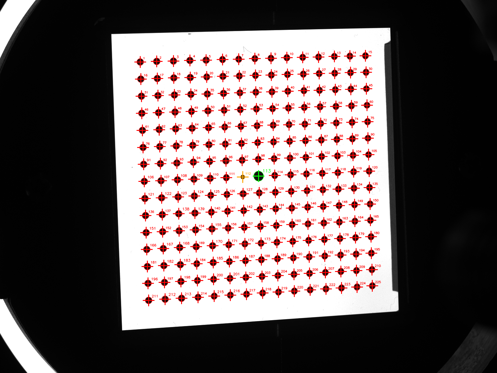
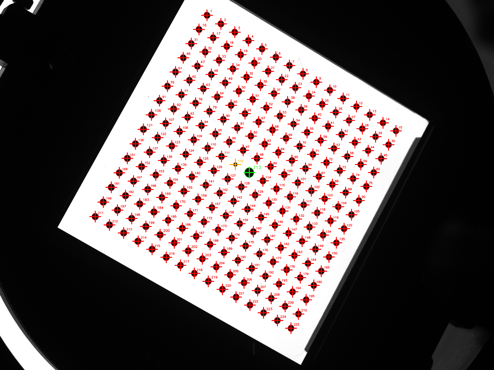
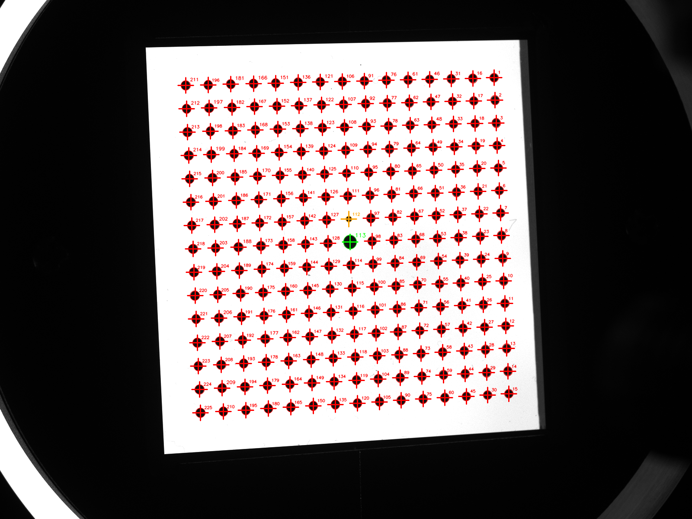

# 工业摄影测量作业 2：圆形标记点识别与中心提取

从二维圆点靶标图像中识别大、中、小圆形标记点，计算中心像素坐标（必做），并按行列编号（选做）。

## 效果展示

实现路线（自定义 Canny + 椭圆拟合 + 主方向编号）：

| 图像 1 | 图像 2 | 图像 3 |
|---|---|---|
|  |  |  |

> 展示图为便于预览的缩略图；原始 BMP 位于 `images/`，完整结果（标注图、坐标 CSV）由程序输出到 `result/`。

## 1. 任务

| 类型 | 任务 | 交付 |
|---|---|---|
| 必做 | 识别大、中、小圆形标记点 | 类别 + 标注图 |
| 必做 | 计算中心坐标 | 像素中心 `(u, v)` + 坐标表 |
| 选做 | 按行列编号 | 行列号、编号、编号图 |

只依赖原始图像，不需要世界坐标和实际点间距。

## 2. 坐标与精度说明

- 图像坐标系：左上角为 `(0, 0)`，`u` 向右、`v` 向下，单位像素。
- 输出使用原始图像坐标；若检测时缩放或裁剪，需转换回原图。
- 路线用**椭圆拟合中心**作为圆点中心：Canny 提取圆点边缘，`cv::fitEllipse` 对轮廓拟合椭圆，取 `RotatedRect.center`。相比二值区域质心，它对阈值分割的偏置、透视变形和部分缺损更稳健，并额外给出长短轴和倾角。
- 中心只保证像素级精度；若需要更高精度，可继续增加亚像素边缘定位。

## 3. 必做流程

路线只使用原图，不依赖光照校正、背景建模或二值分割：

```text
读取原图
  ↓
灰度化 → 3×3 高斯平滑 → 四方向 Sobel → NMS → 双阈值 / BFS 边缘连接
  ↓
findContours(RETR_LIST) → cv::fitEllipse
  ↓
长轴 / 长短轴比 / 拟合残差筛选 → 内外轮廓去重
  ↓
按椭圆面积区分大、中、小圆
  ↓
主方向编号（大圆、小圆定方向；完整网格严格编号，缺点时单应容错）
  ↓
输出标注图、Canny 边缘图、坐标表
```

### 3.1 Canny 边缘检测

主流程先做 3×3 高斯平滑，再计算水平、垂直和两个对角方向的梯度，经过非极大值抑制、双阈值和弱边缘连接得到边缘图。默认阈值为 20 / 110。之后通过轮廓和椭圆拟合提取圆点。

### 3.2 轮廓提取与椭圆拟合

对边缘图做：

```text
findContours(RETR_LIST, CHAIN_APPROX_NONE)
```

`RETR_LIST` 会同时保留圆环的外边界和内部洞边界，二者后续按中心距离去重。

每个轮廓调用 `cv::fitEllipse`，并依次筛选：

| 条件 | 默认值 | 作用 |
|---|---:|---|
| 轮廓点数 | ≥ 5 | `fitEllipse` 的最低要求 |
| 轮廓周长 | 20 ~ 600 px | 滤掉噪声小轮廓和板边超长轮廓 |
| 长轴 | 10 ~ 70 px | 圆点直径范围 |
| 短轴 / 长轴 | ≥ 0.6 | 斜拍时圆变椭圆，但仍比反光/板边轮廓更“圆” |
| 轮廓点到椭圆的平均偏差 | ≤ 1.5 px | 滤掉断边、开口弧和直线粘连 |

残差定义为：

```text
对每个轮廓点，计算它在椭圆归一化坐标下的半径 d
residual = sqrt(mean((d - 1)²)) × (a + b) / 2
```

平均偏差超过 1.5 px 的轮廓通常不是完整圆环，直接丢弃。内外两条轮廓的中心几乎重合，按中心距离 < 3 px 去重，保留点数更多的一条。

### 3.3 提取中心

`Component` 中保存：

```text
cx, cy      = 椭圆中心（像素坐标）
area        = π * major * minor / 4
major, minor, angle, residual
```

椭圆参数直接由 `cv::fitEllipse` 给出，椭圆中心作为圆点中心。当前 pipeline 不做编号后的局部补检。

### 3.4 大、中、小圆分类

按面积中位数分类：

```text
r_eq = sqrt(area / π)
area >= median * 1.6  -> 大圆
area <= median * 0.6  -> 小圆
其余                   -> 中圆
```

椭圆路线使用 `πab/4` 作为面积，透视下比像素计数更稳定。本数据每幅图应得到 1 个大圆、1 个小圆、223 个中圆。

### 3.5 识别结果

在 22 幅 1600 × 1200 图像上：

| 项目 | 结果 |
|---|---|
| 编号成功 | 22 / 22 |
| 候选点数 | 225 点 17 幅；220～223 点 5 幅（图 10、13、17、19、22） |
| 编号方式 | 完整点集直接编号；点数不足时使用容错编号 |
| 备注 | 候选点不足的图片仍能编号成功；编号成功不代表所有格点均已检测到 |
| 分类 | 每幅 1 个大圆 + 1 个小圆 + 其余中圆 |
| 运行时间 | 约 0.14 ~ 0.17 s / 幅（Release） |

当前 3×3 高斯 + 四方向梯度基线的逐图测试中，图 10、13、17、19、22 存在候选点不足；容错编号成功，但未检测到的格点仍保持缺失，不会由栅格先验直接生成中心。


## 4. 输出目录与运行方式

### 代码结构

`src/` 按职责分层，头文件仍统一放在 `include/calib/`（`#include "calib/xxx.hpp"` 不变）：

```text
src/
├── app/         main.cpp（命令行）、gui_main.cpp（Qt 界面）、pipeline.cpp（流程编排）
├── core/        图像读写、灰度、像素工具
├── detect/      自定义 Canny、椭圆拟合
├── numbering/   大中小分类、网格编号
└── output/      标注图绘制、坐标导出
```

新增文件时按职责放进对应目录，并在 `CMakeLists.txt` 的 `add_executable(pipeline ...)` 中登记。

### Qt 简洁界面

依赖 OpenCV 4 和 Qt 5 / Qt 6 Widgets 开发包；Ubuntu 22.04 可安装 `sudo apt install qtbase5-dev`。

```sh
cmake -S . -B build
cmake --build build -j2
build/bin/calibration_gui
# 也可以启动时直接打开图片
build/bin/calibration_gui images/1.bmp
```

操作：**打开图片 → 识别并编号 → 导出结果**。左侧显示原图，右侧显示编号图，并排对比；图片自动适配窗口，支持滚轮缩放、拖动平移。不设置底部信息栏和“适应窗口”按钮。编号失败时仍可查看检测结果并导出，CSV 的编号字段保持为空。

识别通过独立的 `pipeline` 进程执行，不阻塞界面。预览结果暂存在临时目录，关闭后自动清理；点击“导出结果”后，才将结果文件保存到所选目录下的 `<图片主名>/`，覆盖前会确认。`calibration_gui` 和 `pipeline` 需放在同一目录。

无图形环境或只需命令行时，可用 `cmake -S . -B build -DBUILD_GUI=OFF` 关闭 GUI 构建。

### 命令行

```sh
cmake -S . -B build
cmake --build build -j2
build/bin/pipeline images/1.bmp
build/bin/pipeline images/2.bmp
build/bin/pipeline images/3.bmp
```

命令格式为：

```text
pipeline <输入图> [输出根目录]
```

输出根目录默认为当前工作目录下的 `result/`。例如：

```sh
build/bin/pipeline images/1.bmp
build/bin/pipeline images/1.bmp result
```

第二个参数是目录，不是输出图片文件名。程序自动按输入文件主名建立子目录；重复运行会覆盖该图的同名结果。不同来源的同名输入图应使用不同输出根目录。

每幅图的输出：

```text
result/
├── 1/
│   ├── binary.png        # Canny 边缘图
│   ├── annotated.png     # 中心十字、拟合椭圆、分类颜色、网格编号
│   └── coordinates.csv   # 坐标、类别、行列和编号
├── 2/                    # 同上
└── 3/                    # 同上
```

编号成功后，未落到栅格上的误检候选会从结果中剔除。当前 pipeline 不会补出漏检点，因此个别图像的检测点数可能少于 225；编号成功不表示所有格点都已检测到。

每幅图像导出一个 CSV（以下数据仅示意格式）：

```csv
detection_id,type,cx,cy,area,bbox_w,bbox_h,row,col,grid_id
1,medium,442.100,195.400,310,20,19,1,1,1
2,large,816.200,555.100,700,30,29,8,8,113
3,small,765.400,557.800,140,14,13,8,7,112
```

| 字段 | 含义 |
|---|---|
| `detection_id` | 当前图像内部检测序号，非跨图像物理编号 |
| `type` | `large` / `medium` / `small` |
| `cx, cy` | 椭圆拟合中心像素坐标 |
| `area` | 椭圆面积 `πab/4` |
| `bbox_w, bbox_h` | 中心候选的外接矩形宽高（像素） |
| `row, col, grid_id` | 从 1 开始的行、列、网格编号；编号失败时留空 |

`annotated.png` 在原图上绘制中心十字和拟合椭圆；右上方的网格编号按类别区分颜色（大圆绿色、中圆红色、小圆橙色）。

检查：漏检、误检、重复检测、分类是否正确、坐标与图是否逐点对应。

## 5. 选做：按主方向编号

倾斜图像不能直接按 `u`、`v` 排序：同一行的点 `v` 可能不同，透视会使行列向消失点汇聚。本项目的做法是**先用大圆和小圆确定主方向，再在旋转后的坐标系里逐行编号**。

### 5.1 绝对锚点与主方向

靶标为 15 × 15 点阵：

- **大圆**固定在网格中心：第 8 行第 8 列（1-based）；
- **小圆**在大圆左侧一格：第 8 行第 7 列；
- 小圆 → 大圆的方向是列正方向。

以 `L` 为大圆中心、`S` 为小圆中心，定义：

```text
e1 = (L - S) / |L - S|        // 列正方向（主方向）
e2 = (-e1.y, e1.x)            // 行方向
u = (p - L) · e1
v = (p - L) · e2
```

在这个坐标系里，同一行的点近似落在一条斜率很小的直线上，行号由 `v` 排序，列号由 `u` 排序，绝对编号由大圆、小圆的位置确定，不依赖图像从哪一端开始。

### 5.2 完整网格：严格主方向编号

实现见 `src/numbering/grid_numbering.cpp` 的 `number_grid_strict`。候选数正好为 225 时使用：

1. 要求大圆、小圆各只有一个；
2. 在 `(u, v)` 坐标系中枚举点对，拟合候选行直线；只接受斜率绝对值 ≤ 0.30、且线上恰好有 15 个点的直线；
3. 重复 15 次，得到 15 条互不重复的行；
4. 按行截距排序，行内按 `u` 排序；检查相邻点间距在 `0.55 ~ 1.65` 倍基准点距内；
5. 检查相邻行在左右两端都不交叉，行间距在 `0.45 ~ 1.8` 倍基准点距内；
6. 检查每一列也近似共线，防止“数量正确但行内错位”；
7. 检查小圆、大圆在同一行相邻；
8. 全部通过后写入：

```text
row = 行序号（1..15）
col = 列序号（1..15）
grid_id = row × 15 + col + 1
```

### 5.3 板边缺点：单应容错

Canny 在个别板边会漏掉少量点，候选数不是 225。此时严格检查无法要求“每行 15 个”，程序自动切换到 `number_grid_tolerant`：

1. 枚举所有“大圆 × 小圆”组合作为锚点对；
2. 仍用 `e1`、`e2` 建立主方向坐标系；
3. 用仿射初值把候选解到整数 `(i, j)`，保留残差小于 `0.35 × spacing` 的内点；
4. 用 `cv::findHomography(..., RANSAC, 0.25 × spacing)` 拟合 `(i, j)` → 图像坐标，吸收透视；
5. 迭代“重投影 → 取整 → 按节点去重 → 重拟合”；
6. 同一节点只保留残差最小的候选，其余当作误检；
7. 以 `(0, 0) = 大圆`、`(-1, 0) = 小圆` 为绝对基准，得到行列号。

栅格只用于给**已检出**的点分配行列号；没有对应候选的节点保持空缺，不会按先验位置补出一个中心。编号后 `grid_id = 0` 的候选作为误检剔除。

### 5.4 显示编号

编号后**在原图检测中心旁标注，不改变显示位置**：

```python
cv2.putText(img, str(grid_id), (u + 6, v - 6),
            cv2.FONT_HERSHEY_SIMPLEX, 0.4, (0, 0, 255), 1, cv2.LINE_AA)
```

只需坐标逆映射即可判断行列，不必对整张图做逆变换；若确实要输出校正图像再用 `warpPerspective`。

漏点保留缺失网格位置，不压缩编号。检查行列方向、重复占位和跨图像一致性。

## 6. 与相机标定的关系（扩展）

后续标定需把像点与板面坐标对应，并已知实际点间距 `d`：

```text
X = col × d,  Y = row × d,  Z = 0
```

理想无畸变下 `H = λ · K · [r1, r2, t]`，据此初始化内参 `K` 和各幅外参 `R、t`，再联合优化畸变与所有参数。本次必做不涉及。

## 7. 实现顺序

1. 读取原图，检查尺寸。
2. 灰度化 + 3×3 高斯平滑 + 四方向梯度 Canny，得到边缘图。
3. `findContours` + `fitEllipse` + 尺寸/轴比/残差筛选，按中心去重，得到圆点中心。
4. 按面积中位数分类大、中、小圆。
5. 导出坐标表、标注图、边缘图，完成必做。
6. 以大小圆确定主方向，完整网格逐行严格编号；缺点时用单应容错，完成选做。
7. 后续标定：利用网格行列和实际点间距建立像点与世界坐标对应，求 `H` 和相机参数。
